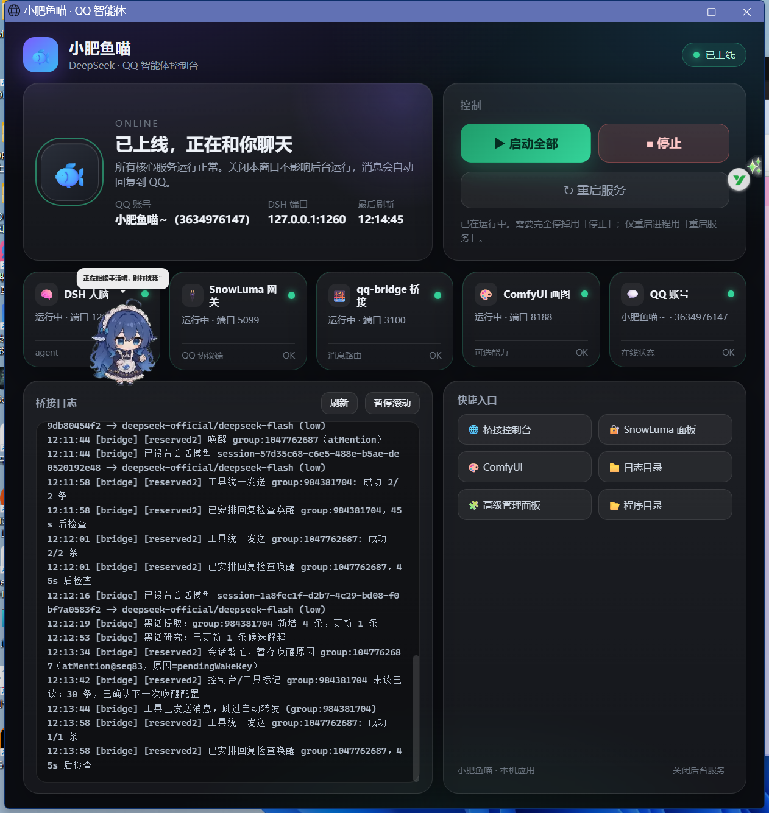
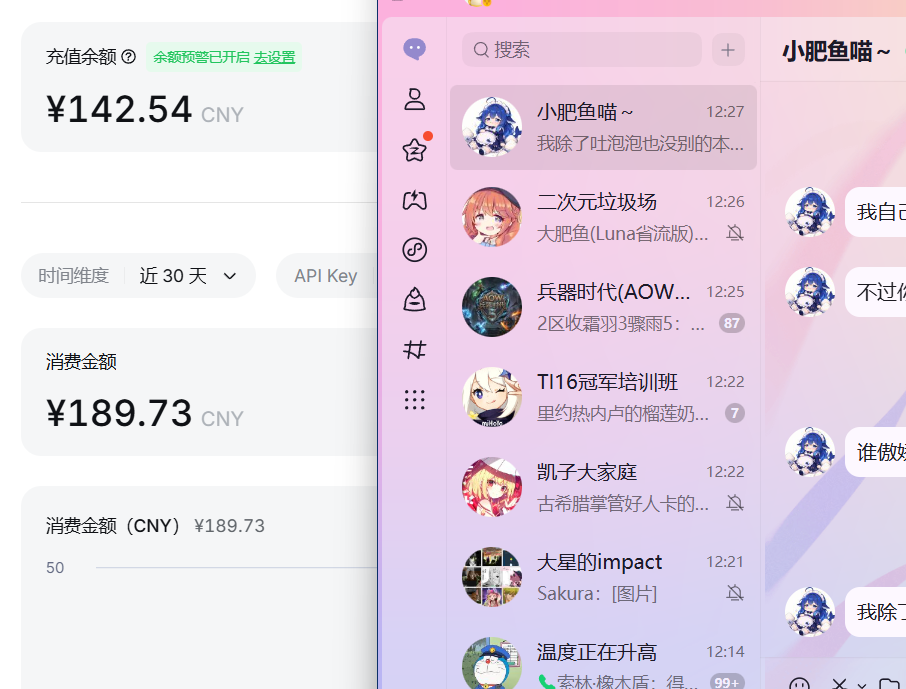

# 小肥鱼喵 · QQ AI 智能体一键部署包

> 让 QQ 里多一个会聊天、会发表情包、会画图、会发语音的 AI 好友。
> 面向小白的 Windows 一键部署方案：**DSH（大脑）+ SnowLuma（QQ 网关）+ qq-bridge（桥接）+ 媒体工具 + 桌面控制台**。




---

## 特性

- 🧠 **DeepSeek 驱动**：通过 DSH Agent 扮演角色，支持人格、群聊、长期记忆、主动发言
- 💬 **像 QQ 好友一样聊天**：私聊/群聊、引用回复、拍一拍、表情包收藏与发送
- 🎨 **会画图**：本地 ComfyUI（RTX 显卡），群友要图直接画一张发出去
- 🎤 **会发语音**：Edge TTS 合成 + 句尾拖音撒娇后期（晓伊音色，可换）
- 🕒 **拟人节奏**：回复延迟、防抖、频率限制、主动找话题、跟随作息上下线
- 🖥️ **桌面控制台**：启动/停止/重启、5 项服务状态灯、实时日志、一键入口（现代深色 UI）
- 🤖 **给 AI 的安装指令**：装完把指令丢给 DSH Agent，让它自动验收和排错

## 需要准备

| 需要 | 说明 |
| --- | --- |
| Windows 10/11 x64 | 至少 10GB 空闲磁盘（画图功能需 20GB） |
| QQ 小号 | 强烈建议只用小号 |
| DeepSeek API Key | 在 platform.deepseek.com 购买后创建 |
| 网络 | 安装器会自动使用国内镜像（npmmirror / ghproxy / hf-mirror） |

## 快速开始（4 步）

1. **安装 DSH**（DeepSeek Harness 桌面版）：https://deepseek-harness.github.io/
2. **安装并启动 SnowLuma**：https://github.com/SnowLuma/SnowLuma/releases/latest
   - 解压 → 双击 `launcher.bat` → 浏览器打开 http://127.0.0.1:5099
   - 同意协议、改密码、用小号手机 QQ 扫码
   - 开启 OneBot **WS 3001** + **HTTP 3000**
3. **双击 `小肥鱼喵一键部署.exe`**：填写 API Key、主号 QQ、安装目录，勾选两个“已就绪”，点开始部署。
4. **验收**：打开桌面「小肥鱼喵」，看到「已上线」；把 API Key 粘贴到 DSH 设置即可开聊。

详细图文步骤见 [docs/小白安装教程.md](docs/小白安装教程.md)。

## 为什么不能做成“一个 exe 全包含”

| 组件 | 是否随包分发 | 原因 |
| --- | --- | --- |
| qq-bridge | ✅ MIT，随包 | 开源可分发 |
| 控制台 / 媒体工具 / 安装器 | ✅ | 本仓库代码 |
| Node.js / ffmpeg / 7zr | ✅ 自动下载/便携化 | MIT / LGPL |
| ComfyUI | ✅ 可选自动下载 | GPL-3.0，从官方 release 获取 |
| **DeepSeek Harness (DSH)** | ❌ | 闭源商业软件，不可再分发 |
| **SnowLuma** | ❌ | 其 EULA 禁止并入第三方安装包/自动化部署 |
| QQ 扫码登录、API Key | ❌ | 账号安全，必须本人操作 |

详见 [COMPLIANCE.md](COMPLIANCE.md)。

## 给 AI Agent 的指令

部署完成后，把 `docs/给AI的安装指令.md` 整段发给你的 DSH Agent，它可以自动：
- 验收 5 个服务、对齐 DSH 端口、重装预设/MCP；
- 按需补装 ComfyUI；
- 按日志定位失败并给出修复命令。

它不会被允许：代扫码、修改 DSH/SnowLuma 程序、读取 API Key。

## 架构

```
QQ 用户 ──> QQ 服务器 ──> SnowLuma (OneBot 3000/3001)
                              │
                              ▼
                    qq-bridge (:3100)  ──排队/唤醒/人格/记忆──> DSH (:port) ──> DeepSeek API
                              │                                   │
                              │                                   └─ 媒体 MCP
                              └────────────── QQ 回复 <─────────────┘
                                        （画图 ComfyUI :8188 / TTS Edge / 表情包）
```

## 目录

```
.
├─ 小肥鱼喵一键部署.exe     # 安装器（C# 编译，无需运行时）
├─ deploy.ps1               # 安装核心逻辑（可 -DryRun）
├─ Installer.cs             # 安装器源码
├─ payload/                 # 随包资源（桥接源码/App/补丁/模板/工具）
├─ docs/                    # 小白教程 + 给 AI 的指令
├─ assets/                  # 截图
└─ dist/                    # 打包好的 zip
```

## 常见问题

- **App 显示未上线**：点「启动全部」；仍不行看 App 内桥接日志或 `docs/给AI的安装指令.md`。
- **收不到回复**：确认 DSH 开着、SnowLuma 在线、主号 QQ 填对（白名单）。
- **画图/语音不工作**：画图需 ComfyUI；语音默认 Edge TTS，需要联网。
- **卸载**：停止服务后删安装目录；删除计划任务 `QQBotStart`/`QQBotStop`；从 DSH profile 的 `cordis.patch.yml` 移除 `mcp-media` 段。

## 致谢与许可

- 桥接核心：[qq-bridge](https://github.com/Derpyu520/qq-bridge)（MIT，Copyright (c) 2026 Derpyu520 and QSH contributors）——本包在其基础上增加了媒体工具（画图/语音/发图）、预设兼容修复与安全白名单扩展。
- QQ 协议端：[SnowLuma](https://github.com/SnowLuma/SnowLuma)（仅集成，不分发，需用户自行安装并同意其 EULA）。
- 智能体运行时：[DeepSeek Harness](https://deepseek-harness.github.io/)（仅集成，不分发）。
- 画图：[ComfyUI](https://github.com/comfyanonymous/ComfyUI)（GPL-3.0，官方渠道下载）。
- 模型：[Counterfeit-V2.5](https://huggingface.co/gsdf/Counterfeit-V2.5)（遵循模型作者许可）。
- Node.js（MIT）、7-Zip（LGPL）、Microsoft Edge（作为窗口载体，未分发）。

本项目代码以 [MIT](LICENSE) 发布。第三方组件的许可与归属见 [NOTICE.md](NOTICE.md)。

## 免责声明

- 第三方协议端登录 QQ 存在风控/封号风险，请使用小号并遵守 QQ 用户协议。
- 本项目仅供学习与技术研究，不提供任何账号、API 或服务。
- 使用本项目产生的账号、费用、内容与法律责任由使用者自行承担。
